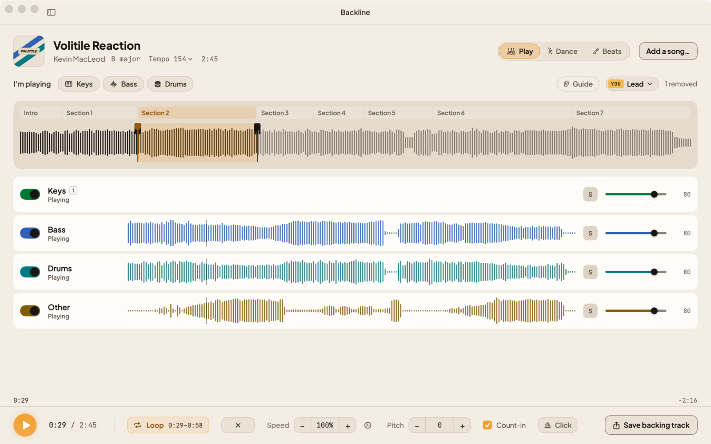
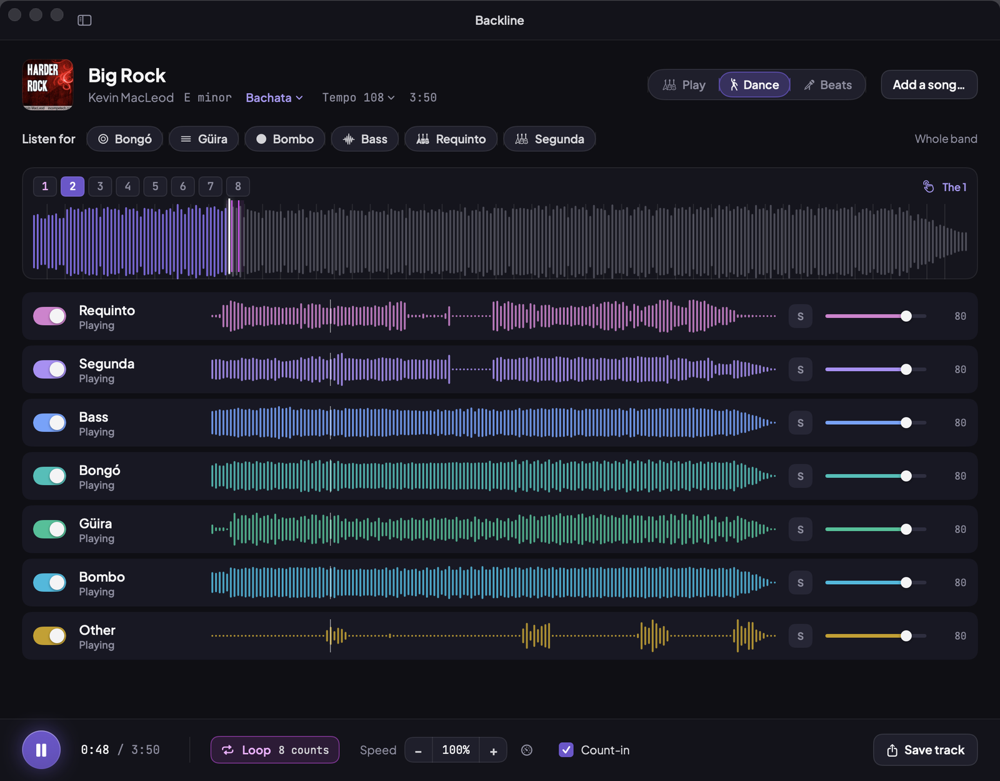
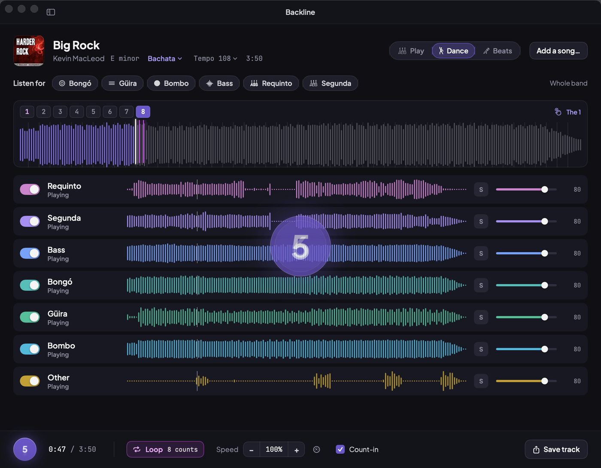
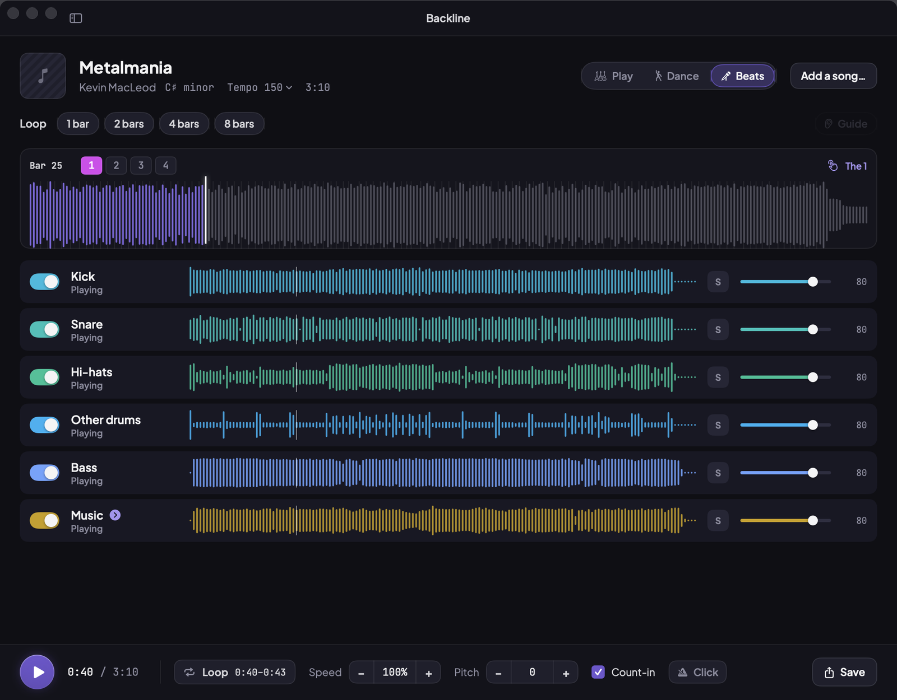
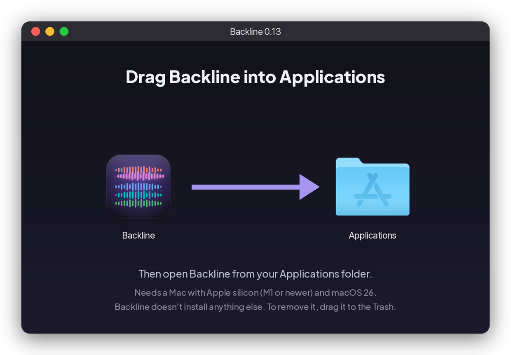
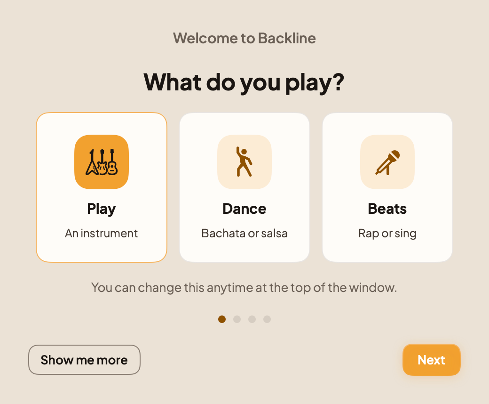
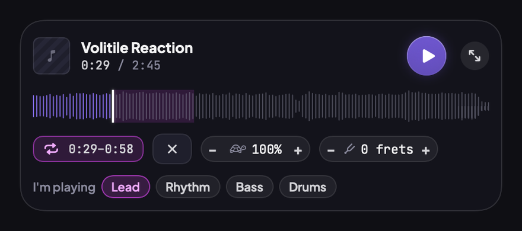

# Backline

## [⬇ Download Backline for Mac](https://github.com/alexpizarro/backline/releases/latest/download/Backline.dmg)

Free. For Macs with Apple silicon (M1 or newer) on macOS 15 Sequoia or newer. Open the file, drag Backline into
Applications, and you're done.

---

**A Mac practice player for musicians, dancers and singers. Drop in a song, take it apart, and practise.**

Backline splits a song into instruments on your Mac. Nothing is uploaded. Pick how you practise:

- **Play:** turn off the part you play (even just the lead guitar) and play along with the band.
- **Dance:** hear one instrument at a time, tap on the 1, and Backline counts to 8 for you.
- **Beats:** the singer is off, the drums split into kick, snare and hi-hats, and loops snap to the bar.

Then loop, slow down or speed up, count in, and save the result as a track.



## Three ways to practise

Switch at the top of any song, or press ⌘1, ⌘2 or ⌘3. Each mode shows only what that kind of practice
needs, and each song remembers its mode.

### Dance

Made for bachata, salsa and other partner dances. **Listen for** brings one part forward (bongó, güira,
bass, guitar…) while the rest plays softly. Play the song, **tap on the 1**, and the counts 1 to 8 run
with the music. Nothing counts until you tap, so a wrong guess never confuses you. Loops are whole
eights, and the count-in says 5, 6, 7, 8 like a teacher. In bachata the guitars are called requinto and
segunda, and the drums split into bongó, güira and bombo.





### Beats

Made for rapping and singing over a beat. The singer starts off. One click loops 1, 2, 4 or 8 bars,
starting right on the beat. Tap on the 1 and the bar and beat counter runs. The drums split into kick,
snare, hi-hats and the rest. **Music** holds the guitars and keys, and opens into its parts when you
click its arrow.



## Quick install

**You need:** a Mac with Apple silicon (M1 or newer, like a 2022 MacBook Air) running macOS 15 Sequoia,
macOS 26 Tahoe or macOS 27 Golden Gate, and about 2 GB of free space.
No Terminal and no admin password. The first time it opens, Backline quietly downloads two extra models
(about 550 MB, once) that make the parts cleaner and split the drums. Until they arrive, everything still
works with the models built in.

**1. Download.** Click **[Download Backline for Mac](https://github.com/alexpizarro/backline/releases/latest/download/Backline.dmg)**.
Your browser saves **Backline.dmg** in **Downloads**.

**2. Open it and drag Backline into Applications.** Double-click the file you downloaded. This window
opens. Drag the Backline icon onto the Applications folder.



*(Picture of the installer window. The version number in its title is the version you downloaded.)*

**3. Open Backline.** Open your **Applications** folder and double-click **Backline**. The first time,
your Mac asks *"Backline is an app downloaded from the Internet. Are you sure you want to open it?"*
Click **Open**. That's normal for any app you download, and you only see it once. Backline is signed and
checked by Apple, so you won't get any other warning.

**4. Say hello.** The welcome asks what you practise: play an instrument, dance, or rap and sing. That
sets the first mode, and you can change it at the top of the window whenever you like. Then drop in a song.



**What to expect**
- The first time you add a song, Backline takes a few seconds to split it (about 5 seconds on an M3 Max,
  up to a minute on older Macs). After that, it opens instantly. A sharper model then splits it again in
  the background, and the header says so. You can keep playing, and the cleaner parts swap in at your
  next pause.
- **Memory:** Backline keeps the parts of the song you're playing in memory (about 100 MB per minute of
  song), and the two background models need a few hundred MB more while they run. **16 GB is
  recommended**, and comfortable for songs up to about 10 minutes. **8 GB works for ordinary 3 to 5 minute
  songs** if other big apps are closed; on 8 GB, let the cleaner pass finish before you play. On a busy
  Mac the background steps just take longer. Backline stays usable and you can keep playing.
- **Speed on an M1:** expect a few tens of seconds before a new song opens, and a few minutes for the
  cleaner parts. Newer chips are several times faster.
- **Space:** about 200 MB per song (the parts plus the original, so the cleaner pass can run later).
- **Record from an app:** the first time, macOS asks if Backline can record your system audio. Click
  **Allow**. Backline only records the app you pick.
- **YouTube links:** most just work. If YouTube says to sign in, Backline shows a button to sign in on
  Google's own page inside the app, with your Google email and password. Passkeys can't be used there
  (Apple only allows them in web browsers), so Backline shows you how to pick your password instead.
  Backline never sees your password.
- **Help** is built in: choose **Help ▸ Backline Help**, or click any **?** button.
- **To remove Backline,** drag it from Applications to the Trash. It doesn't install anything else.
  The extra models and your songs live in its own folder (Settings ▸ Show Folder).

## Why it exists

I built Backline for my son. He plays lead guitar, mostly heavy metal, and wanted to practise solos over
the real band.

Most stem-splitting apps, including [StemDeck](https://github.com/stemdeckapp/stemdeck), which inspired
this project, give you a single guitar track. Mute it and the rhythm guitars disappear along with the
solo, so you're left soloing over bass and drums. His main requirement was **separate lead and rhythm
guitar**, so that's what Backline does best.

Since then, other people asked to use it for dancing bachata and salsa, and for rapping and singing over
beats with the drums split up. That is why Backline now has three modes, and why each one stays simple.

If you want a cross-platform or general-purpose stem splitter, StemDeck is a better fit. See the
[side-by-side comparison](docs/comparison-stemdeck.md).

Backline also builds on lessons from [Count8](https://count8.app), a separate app I make for social
dancing. Things learned there, like getting a song's audio from a YouTube link and keeping the app easy
for non-technical people, were reused here.

## What it does

- **Lead and rhythm guitar as separate tracks.** Remove the solo and keep the rhythm. An AI model trained
  on lead vs rhythm guitar works together with a stereo method, all built in. It works best on the usual
  metal and rock mix, with rhythm guitars panned left and right and the solo in the centre.
- **"I'm playing."** In Play mode, one click removes your part (lead, rhythm, bass, drums or vocals) and
  is remembered for the next song. Guide mode plays your part quietly for reference.
- **Cleaner parts.** Songs open in seconds, then a sharper model (BS-RoFormer) splits them again in the
  background. On a standard test set every part comes out about 2 to 3 dB cleaner.
- **A split drum kit.** Kick, snare, hi-hats and the rest, made on your Mac in about 10 to 30 seconds.
- **Slow down or speed up without changing key** from 50 % to 150 %. A **speed trainer** raises the tempo
  a little each time the loop comes round.
- **Loops that snap to beats and bars.** Song sections are found automatically; click one to loop it.
  If a solo is found, the song opens with it already looped.
- **Count-in and click** on the song's real beats. **Change the pitch** up to 12 frets up or down.
- **Mini player** that floats over tabs, a DAW or a video lesson.
- **Get songs in** from a file, a YouTube link, or by recording from any app on your Mac.
- **Save a track** (WAV, AIFF or MP3) with your speed and pitch applied.
- Everything runs on your Mac, on its graphics chip. A song is ready in about 11 seconds on an M3 Max; the
  cleaner parts follow about a minute later.



## Download

It's free. See [Quick install](#quick-install) above. Every release is in
[Releases](https://github.com/alexpizarro/backline/releases), signed with an Apple Developer ID and
notarized by Apple. Each one lists what changed.

Only use songs you're allowed to use. Downloading from YouTube may be against YouTube's terms. No songs
are included with Backline.

## Other projects worth a look

| Project | What it is |
|---|---|
| [StemDeck](https://github.com/stemdeckapp/stemdeck) | Free, cross-platform stem splitter with a DAW-style mixer. Mac, Windows, Linux, Docker |
| [Demucs](https://github.com/adefossez/demucs) | Meta's open music-separation model. Backline uses its 6-stem version |
| drypaint lead/rhythm model | A community HTDemucs model that separates lead from rhythm guitar. Backline blends it with its own stereo method |
| [Ultimate Vocal Remover](https://github.com/Anjok07/ultimatevocalremovergui) | The go-to desktop app for vocal and instrument separation, with many models |
| [python-audio-separator](https://github.com/nomadkaraoke/python-audio-separator) | Command-line and Python access to the UVR models |
| [Music-Source-Separation-Training](https://github.com/ZFTurbo/Music-Source-Separation-Training) | Training code and many community models, including the BS-RoFormer and DrumSep models Backline downloads |
| [Beat This!](https://github.com/CPJKU/beat_this) | Accurate beat and downbeat tracker. Backline uses it for the click, the counts and loop snapping |
| [Signalsmith Stretch](https://github.com/Signalsmith-Audio/signalsmith-stretch) | High-quality time-stretch and pitch-shift library behind Backline's speed control |
| [JammLab](https://github.com/cyberflow/JammLab) | Another native macOS practice app with on-device stem separation |
| [go-play-in-the-band](https://github.com/brucehoppe/go-play-in-the-band) | Play-along practice app for guitarists; the idea for Backline's speed trainer came from here |
| [yt-dlp](https://github.com/yt-dlp/yt-dlp) | The downloader behind Backline's YouTube import. Backline compiles it from source to native code with [Nuitka](https://nuitka.net) and bundles it, so nothing needs installing |
| [QuickJS-NG](https://github.com/quickjs-ng/quickjs) | Small, fast JavaScript engine. yt-dlp uses it to solve YouTube's playback checks |

## Updates and feedback

Backline is a personal project. I'm the only person who makes changes, and I don't take pull requests.
Bug reports and ideas are welcome as [issues](https://github.com/alexpizarro/backline/issues).

## Build from source

You need Xcode 26, [XcodeGen](https://github.com/yonaskolb/XcodeGen) and [Git LFS](https://git-lfs.com).
The models, fonts and bundled tools are stored in LFS. The prebuilt YouTube downloader in
`Vendor/yt-dlp/` is rebuilt from source with `scripts/build-ytdlp.sh` (needs [uv](https://docs.astral.sh/uv/)).

```sh
git lfs pull
xcodegen generate
xcodebuild -project Backline.xcodeproj -scheme Backline -configuration Release build
swift test --package-path BacklineKit      # engine and DSP tests
```

- **Code:** `Backline/` holds the app, `BacklineKit/` the audio engine and analysis, and `ml/` the model
  conversion scripts.
- **The two extra models** (cleaner parts and the drum kit) are not in the repository. A build downloads
  them the first time it runs, from the [models release](https://github.com/alexpizarro/backline/releases/tag/models-1),
  and checks them. `ml/convert_roformer.py` and `ml/convert_drumsep.py` show how they were converted to
  Core ML.
- **Releases:** each release is a git tag (`v0.17`, …) with its installer attached.

## Licences

- **Models:** BS-RoFormer SW (checkpoint by jarredou, no licence published) for the cleaner parts, and
  MDX23C DrumSep by jarredou and aufr33 (CC BY-NC-SA 4.0) for the drum kit. Both are downloaded once from
  this repo's [models release](https://github.com/alexpizarro/backline/releases/tag/models-1) and checked.
  Beat This! (code and weights MIT). Lead/rhythm guitar model by drypaint (HTDemucs, via MVSep community).
  Demucs: the code is MIT; Meta's pretrained HTDemucs weights are not under MIT and are described by their
  author as provided for research purposes. Backline is free and non-commercial and credits them.
- **Audio code:** Signalsmith Stretch and Linear (MIT). LAME (LGPL, loaded as a replaceable library).
- **YouTube import:** yt-dlp (Unlicense), compiled with Nuitka, with its bundled libraries (certifi MPL-2.0,
  pycryptodomex BSD/Public Domain, Brotli MIT, websockets BSD, requests Apache-2.0, urllib3 MIT, yt-dlp-ejs
  Unlicense, CPython PSF). QuickJS-NG (MIT).
- **Fonts:** Plus Jakarta Sans and JetBrains Mono (OFL).
- **Full notices:** [Acknowledgements](Backline/Resources/Acknowledgements.txt).
- **Screenshots:** the demo songs are "Volatile Reaction", "Big Rock" and "Metalmania" by Kevin MacLeod
  ([incompetech.com](https://incompetech.com), Creative Commons: By Attribution, CC BY).

<!-- readme-reviewed-for: 0.17 -->
<!-- screenshots-taken-with: 0.17 -->
